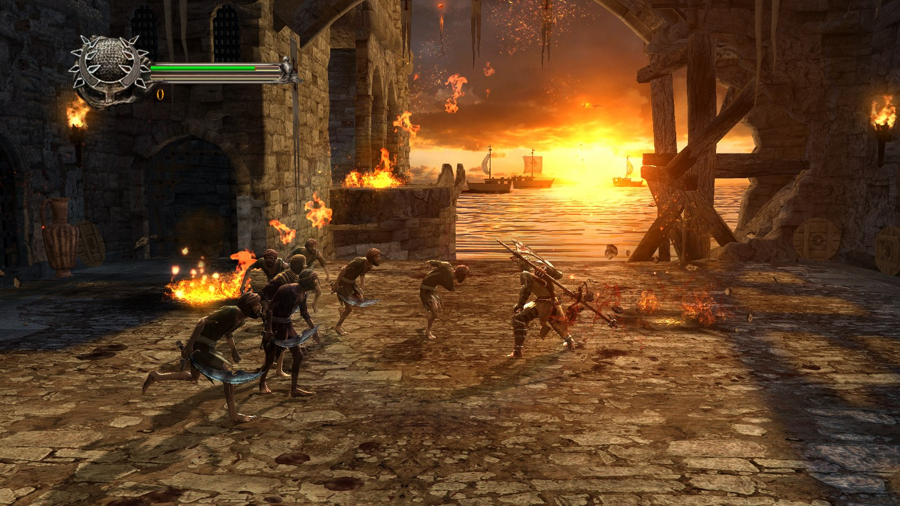
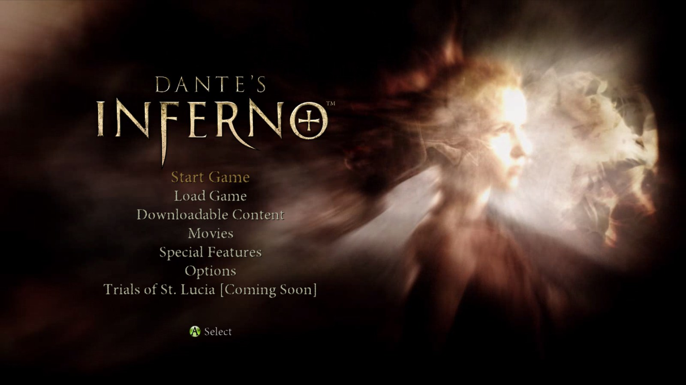
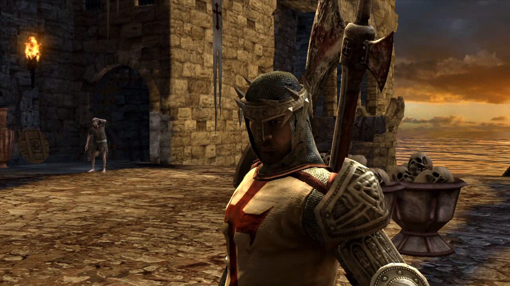

# Dante's Inferno — port nativo para PC

Port do **Dante's Inferno** (Xbox 360) por **recompilação estática**: o código PowerPC do jogo é traduzido para C++ e compilado como um programa de Windows. Não há emulador de CPU rodando o jogo. A parte gráfica usa o runtime da [ReXGlue](https://github.com/rexglue/rexglue-sdk), derivado do [Xenia](https://xenia.jp).

**Nada do jogo vem neste repositório.** O port é gerado no seu PC a partir da sua própria cópia (a imagem `.iso` do disco). O código traduzido também é gerado aí e nunca é distribuído.

O runtime vem de uma compilação própria da ReXGlue com o AMD FidelityFX e correções do port ([otavix010/rexglue-sdk-ffx](https://github.com/otavix010/rexglue-sdk-ffx)), porque a oficial não traz o FidelityFX. Entre as correções está a da escala de resolução no D3D12, que derrubava o jogo acima de 1x.

O jeito mais fácil de jogar é pelo [Otavix Launcher](https://github.com/otavix010/otavix-launcher), que baixa este port, pede a sua `.iso`, gera tudo e cuida das opções.



## O que o port acrescenta

| | Xbox 360 | Port |
|--|--|--|
| Taxa de quadros | 60 fps | **60** ou **120** fps (quadros reais; a interface fica a 60) |
| Resolução interna | 720p | 720p, **1440p** ou 4K |
| Ampliação para a tela | — | AMD FSR 1, AMD CAS, FSR 3 temporal (experimental) ou bilinear, com nitidez ajustável |
| Anti-aliasing | o do jogo | o do jogo, mais FXAA opcional |
| Filtro anisotrópico | o do jogo | até 16x |
| Contador de fps | — | opcional, no canto da tela |

DLSS e XeSS não entram: os dois precisam de vetores de movimento, que os jogos de Xbox 360 não fornecem. O ganho de nitidez vem da resolução interna (supersampling de verdade), e a fluidez vem dos fps reais.

| Menu | Dante |
|---|---|
|  |  |

## Estado dos testes

- Do menu ao combate: 15 minutos no navio em chamas a 60 fps estáveis em 2x (GPU em 29%).
- Som funcionando.
- 120 fps: o jogo avança 1/120 por quadro (a taxa e o passo ficam lado a lado na memória do jogo), e a interface, presa a 60 Hz, pulsa no mesmo ritmo que a 60 fps (0,83 s medidos nos dois casos). Menus, pausa e toques de 10 ms funcionam.

## Gerar à mão (sem o launcher)

Precisa do **Visual Studio 2022 Build Tools** com "Desenvolvimento para desktop com C++" e "C++ CMake tools for Windows". O gerador baixa o resto: o SDK da ReXGlue e o Clang (LLVM) portátil, numa pasta `_ferramentas` ao lado do port.

```powershell
.\gerar.ps1 -Iso "D:\Jogos\Dante's Inferno (USA, Europe).iso"
.\jogar.cmd
```

O port foi feito a partir do **Dante's Inferno (USA, Europe)**. O gerador confere o `default.xex` da sua `.iso` (SHA-1 `98bff97ab205fc9893bf49e8c79b26711f6b18db`) e avisa se for outra versão.

## Opções

Ficam em `dantesinferno.toml` ao lado do executável, ou no arquivo indicado pela variável `PORT_OPCOES`. O launcher grava em `opcoes.toml`. Cada uma também vale na linha de comando (`--fps 120`) ou como variável de ambiente (`REX_FPS=120`).

| Opção | Valores | Padrão |
|--|--|--|
| `fps` | 60, 120 | 60 |
| `resolution_scale` | 1 (720p), 2 (1440p), 3 (4K) | 2 |
| `filtro` | `fsr`, `cas`, `fsr3` (temporal, experimental), `bilinear` | `fsr` |
| `nitidez` | 0 a 100 | 70 |
| `swap_post_effect` | `none`, `fxaa`, `fxaa_extreme` | `none` |
| `anisotropic_override` | -1 (o do jogo), 3 (4x), 4 (8x), 5 (16x) | 5 |
| `fullscreen` | `true`, `false` | `true` |
| `monitor` | 0 (padrão), 1, 2... | 0 |
| `mostrar_fps` | `true`, `false` | `false` |
| `volume` | 0 a 100 | 100 |
| `alvos` | `auto`, `rov`, `rtv`: como a EDRAM é imitada; `auto` usa o caminho medido melhor para o jogo | `auto` |
| `vibration` | `true`, `false` | `true` |
| `zona_morta_esquerda`, `zona_morta_direita` | 0 a 50 (%) | 0 |
| `user_language` | 1 inglês, 4 francês, 5 espanhol | 1 |
| `iso` | caminho da `.iso` | — |

## Como funciona

- `config/funcoes.toml`: as funções que a análise estática não acha sozinha: chamadas só por ponteiro (nos dados ou com o endereço montado no código) e uma função cuja análise começava no meio de um laço. `config/ganchos.toml`: os ganchos no código do jogo. `config/jogo.txt`: a versão do jogo que o gerador confere.
- A taxa de quadros (`src/port/frame_rate.h`): o jogo já roda a 60 no Xbox 360, sincronizado ao vblank; acima de 60, o vblank do console emulado acelera, e o jogo, que lê a taxa ao iniciar, passa a avançar 1/taxa por quadro.
- `src/ui_rate.h`: a interface (o Flash da EA, "APT") avança um passo por quadro e correria em dobro a 120. Os dois tratadores dela (telas e filmes) só rodam a cada 1/60 s de tempo real, decididos juntos, e enquanto rodam o estado anterior dos botões é o do último quadro dela, para nenhum aperto se perder. A técnica é a que o [hells-gate-recomp](https://github.com/florinp93/hells-gate-recomp) documenta (`docs/frame_rate.md`); os endereços foram achados de novo nesta versão do jogo.
- `src/port/`: a base comum dos ports de Xbox 360 (a mesma em todos): opções de imagem, contador de fps, leitura da `.iso`, a trava que corrige uma corrida na entrada de controles da ReXGlue, `falha.log` com a pilha em caso de falha.

Para desenvolver: `build.cmd` compila; `scripts/rodar.py` roda numa janela com prints, o fps de cada segundo e um controle roteirizado (`PORT_PAD`; para começar um jogo novo: `--pad 26:START,35-180@4:A`); `scripts/tecla.py` aperta botões no jogo em execução; `scripts/varrer_ponteiros.py` e `scripts/desmontar.py` ajudam a achar funções.

## Créditos

- [ReXGlue SDK](https://github.com/rexglue/rexglue-sdk): recompilador estático e runtime de Xbox 360 (BSD-3).
- [Xenia](https://github.com/xenia-project/xenia): o emulador em que o runtime se baseia (BSD-3).
- [hells-gate-recomp](https://github.com/florinp93/hells-gate-recomp), de florinp93: a documentação de como a interface do Dante's Inferno avança, que guiou a técnica dos 120 fps (nenhum código dele foi usado).

Dante's Inferno é marca da Electronic Arts. Este projeto não tem relação com a EA nem com a Microsoft.

## Licença

O código deste repositório está sob a licença MIT (`LICENSE`). O SDK e o runtime têm a licença própria deles (BSD-3).
