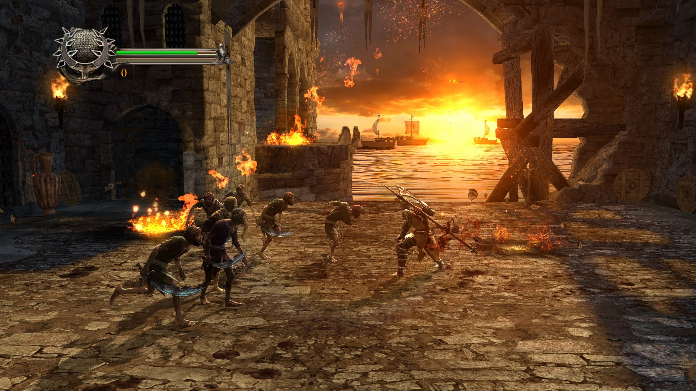
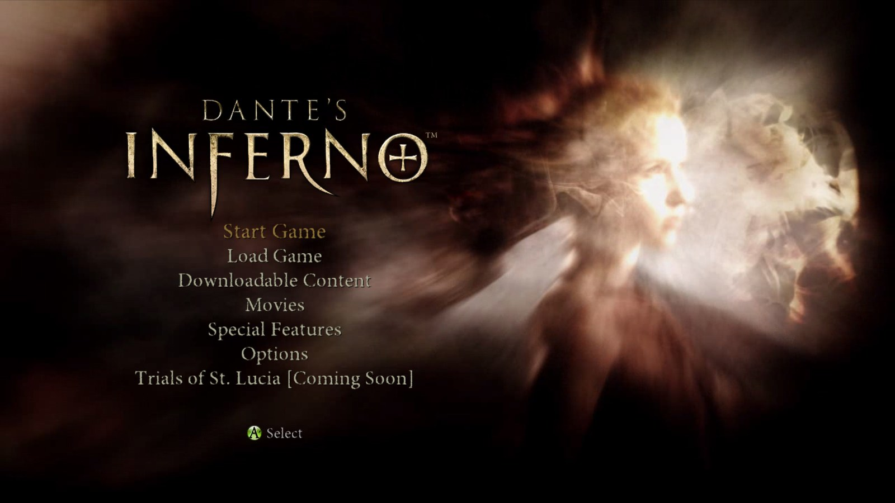
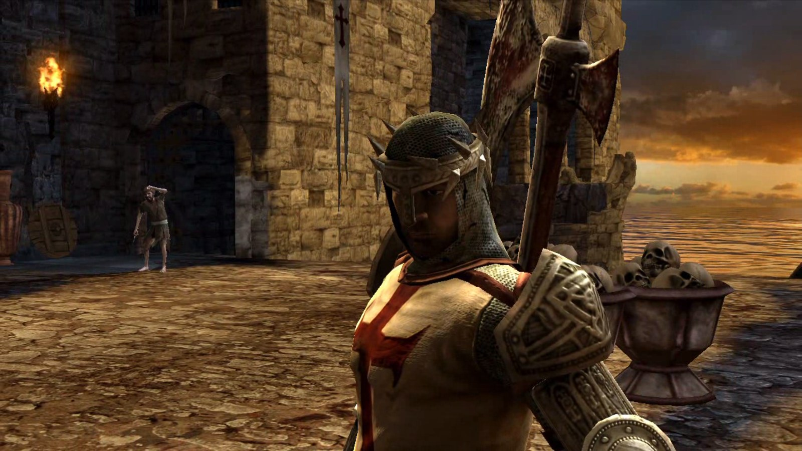

<h1 align="center">Dante's Inferno — port nativo para PC</h1>

<p align="center"><i>Dante's Inferno (Xbox 360) — port nativo para PC por recompilação estática (Otavix Engine 360). Gera a partir da sua .iso.</i></p>

<p align="center">
  <a href="https://github.com/otavix010/dantes-inferno-pc/commits/main"></a>
  <a href="LICENSE"></a>
  <a href="https://github.com/otavix010/otavix-launcher/releases/latest"></a>
  
  
</p>

<p align="center">
  <a href="#o-que-o-port-acrescenta">O que o port acrescenta</a> ·
  <a href="#estado-dos-testes">Estado dos testes</a> ·
  <a href="#plataformas">Plataformas</a> ·
  <a href="#requisitos">Requisitos</a> ·
  <a href="#desempenho-medido">Desempenho</a> ·
  <a href="#perguntas-frequentes">Perguntas frequentes</a> ·
  <a href="#gerar-à-mão-sem-o-launcher">Gerar à mão (sem o launcher)</a> ·
  <a href="#opções">Opções</a> ·
  <a href="#como-funciona">Como funciona</a>
</p>

> [!IMPORTANT]
> **Para jogar, baixe o [Otavix Launcher](https://github.com/otavix010/otavix-launcher/releases/latest).** Ele baixa este port, pede a sua `.iso`, gera o jogo no seu PC e o mantém atualizado. Para relatar um problema ou pedir algo, use **"Reportar problema"** na página do jogo no launcher: o relatório já vai com o log e as configurações, e é por ele que as correções saem mais rápido.
>
> **To play, download the [Otavix Launcher](https://github.com/otavix010/otavix-launcher/releases/latest).** It downloads this port, asks for your `.iso`, makes the game on your PC and keeps it updated. To report a problem or ask for something, use **"Report a problem"** on the game's page in the launcher: the report carries the log and the settings, and that is how fixes come out fastest.

Port do **Dante's Inferno** (Xbox 360) por **recompilação estática**: o código PowerPC do jogo é traduzido para C++ e compilado como um programa de Windows. Não há emulador de CPU rodando o jogo. A parte gráfica usa o runtime da **Otavix Engine 360**, derivado do ReXGlue e do [Xenia](https://xenia.jp) (veja os Créditos).

**Nada do jogo vem neste repositório.** O port é gerado no seu PC a partir da sua própria cópia (a imagem `.iso` do disco). O código traduzido também é gerado aí e nunca é distribuído.

O runtime é a **Otavix Engine 360 1.0.0** (privada): o gerador baixa o pacote pronto do servidor do launcher e confere o SHA-256. Ela descende do ReXGlue e do Xenia (BSD-3, veja os Créditos) e traz o AMD FidelityFX e as correções do port; os avisos de licença vão no pacote.

O jeito mais fácil de jogar é pelo [Otavix Launcher](https://github.com/otavix010/otavix-launcher), que baixa este port, pede a sua `.iso`, gera tudo e cuida das opções.



## O que o port acrescenta

| | Xbox 360 | Port |
|--|--|--|
| Taxa de quadros | 60 fps | **60** ou **120** fps (quadros reais; a interface fica a 60) |
| Resolução interna | 720p | 720p, **1440p** ou 4K |
| Ampliação para a tela | — | AMD FSR 1, AMD CAS, FSR 3 temporal (experimental) ou bilinear, com nitidez ajustável |
| Anti-aliasing | o do jogo | o do jogo, mais FXAA opcional |
| Filtro anisotrópico | o do jogo | até 16x |
| Contador de fps | — | opcional, no canto da tela |

DLSS e XeSS não entram: os dois precisam de vetores de movimento, que os jogos de Xbox 360 não fornecem. O ganho de nitidez vem da resolução interna (supersampling de verdade), e a fluidez vem dos fps reais.

| Menu | Dante |
|---|---|
|  |  |

## Estado dos testes

- Do menu ao combate: 15 minutos no navio em chamas a 60 fps estáveis em 2x (GPU em 29%).
- Som funcionando.
- 120 fps: o jogo avança 1/120 por quadro (a taxa e o passo ficam lado a lado na memória do jogo), e a interface, presa a 60 Hz, pulsa no mesmo ritmo que a 60 fps (0,83 s medidos nos dois casos). Menus, pausa e toques de 10 ms funcionam.

## Plataformas

| | **Windows** | **Linux / SteamOS** |
|---|---|---|
| Situação | **funciona** (este port) | **não suportado e não testado** |
| Vídeo | Direct3D 12 (o Agility SDK vai ao lado do exe) | o runtime só tem o caminho D3D12 no Windows |
| Como jogar | pelo launcher, ou `gerar.ps1` e `jogar.cmd` | só o port de *God of War: Ascension* tem versão Linux (beta) por enquanto |

## Requisitos

- **Windows 10/11 64 bits** e GPU com **Direct3D 12**.
- **CPU x86-64 com SSE4.1.** AVX não é obrigatório: o gerador compila no seu PC com `-march=native` e usa o que o processador tiver.
- **Visual Studio 2022 Build Tools** com "Desenvolvimento para desktop com C++" e "C++ CMake tools for Windows" (o launcher confere).
- **A sua `.iso`** do *Dante's Inferno* (Dante's Inferno).
- **Memória:** o mínimo exato não foi medido. Um cuidado medido: a compilação completa com 16 jobs chegou a ~35 GB de memória comprometida; o gerador limita os jobs (`-Jobs 4` é seguro).
- **Disco:** não medido com precisão: a `.iso`, mais as ferramentas (a engine, ~14 MB, e o Clang portátil) e a pasta de compilação.

## Desempenho medido

FPS de jogo. **Só colocamos o que foi medido**, e com **um jogo só rodando** (com outra carga junto, o desempenho pode cair bastante). Foram medidos no runtime anterior; na engine 1.0.0 a saída da GPU saiu **idêntica quadro a quadro** nos 4 ports e o boot não falhou, mas os FPS **ainda não foram remedidos**.

| Máquina | CPU | GPU | FPS |
|---|---|---|---|
| **PC 1** | Ryzen 7 9800X3D | RTX 5080 | 2x: 15 min no navio em chamas a **60 estáveis** (GPU em 29%); 120 funciona (a interface fica presa a 60) |
| **PC 2** | Core i5-11400F | RX 9060 XT | 60 em 97% do trecho da igreja até a lava; só a transição da catedral cai (12–30) (04/11) |
| **Notebook** | Core i5-10300H (4/8) | GTX 1650 | não medido |
| **Portátil** | Legion Go S (Linux) | Radeon 780M | não suportado |

DLSS e XeSS não existem para estes jogos (o Xbox 360 não fornece vetores de movimento); o FSR e o CAS atuam só na saída.

## Problemas conhecidos

- **Tela preta perto do "Pole Climb"** (reports 811, 813 e 1003, em AMD e com ISO modificada): ainda **não reproduzimos** na RTX 5080 nem na RX 9060 XT.
- A transição da catedral cai de FPS (medido no PC 2).

## Gerar à mão (sem o launcher)

Precisa do **Visual Studio 2022 Build Tools** com "Desenvolvimento para desktop com C++" e "C++ CMake tools for Windows". O gerador baixa o resto: a Otavix Engine 360 e o Clang (LLVM) portátil, numa pasta `_ferramentas` ao lado do port.

```powershell
.\gerar.ps1 -Iso "D:\Jogos\Dante's Inferno (USA, Europe).iso"
.\jogar.cmd
```

O port foi feito a partir do **Dante's Inferno (USA, Europe)**. O gerador confere o `default.xex` da sua `.iso` (SHA-1 `98bff97ab205fc9893bf49e8c79b26711f6b18db`) e avisa se for outra versão.

## Opções

Ficam em `dantesinferno.toml` ao lado do executável, ou no arquivo indicado pela variável `PORT_OPCOES`. O launcher grava em `opcoes.toml`. Cada uma também vale na linha de comando (`--fps 120`) ou como variável de ambiente (`REX_FPS=120`).

| Opção | Valores | Padrão |
|--|--|--|
| `fps` | 60, 120 | 60 |
| `resolution_scale` | 1 (720p), 2 (1440p), 3 (4K) | 2 |
| `filtro` | `fsr`, `cas`, `fsr3` (temporal, experimental), `bilinear` | `fsr` |
| `nitidez` | 0 a 100 | 70 |
| `swap_post_effect` | `none`, `fxaa`, `fxaa_extreme` | `none` |
| `anisotropic_override` | -1 (o do jogo), 3 (4x), 4 (8x), 5 (16x) | 5 |
| `fullscreen` | `true`, `false` | `true` |
| `monitor` | 0 (padrão), 1, 2... | 0 |
| `mostrar_fps` | `true`, `false` | `false` |
| `volume` | 0 a 100 | 100 |
| `alvos` | `auto`, `rov`, `rtv`: como a EDRAM é imitada; `auto` usa o caminho medido melhor para o jogo | `auto` |
| `vibration` | `true`, `false` | `true` |
| `zona_morta_esquerda`, `zona_morta_direita` | 0 a 50 (%) | 0 |
| `user_language` | 1 inglês, 4 francês, 5 espanhol | 1 |
| `iso` | caminho da `.iso` | — |

## Perguntas frequentes

**Este repositório tem o jogo?** Não. Você precisa da sua cópia (a imagem `.iso` do disco); o gerador monta o port no seu PC.

**Roda no Linux ou no SteamOS?** Ainda não: só o port de *God of War: Ascension* tem versão Linux (beta). Este roda no Windows.

**Saiu atualização. O que acontece com o jogo e os saves?** Atualize pelo launcher: ele refaz a tradução e a compilação uma vez (o gerador guarda a versão do runtime em `out\gerar\sdk.txt`). O jogo e os saves ficam.

**A `.iso` está danificada ou cortada.** O port agora recusa a imagem e diz o motivo no log, em vez de fechar.

**Onde relato um problema?** No launcher, em **"Reportar problema"** na página do jogo.

## Como funciona

- `config/funcoes.toml`: as funções que a análise estática não acha sozinha: chamadas só por ponteiro (nos dados ou com o endereço montado no código) e uma função cuja análise começava no meio de um laço. `config/ganchos.toml`: os ganchos no código do jogo. `config/jogo.txt`: a versão do jogo que o gerador confere.
- A taxa de quadros (`src/port/frame_rate.h`): o jogo já roda a 60 no Xbox 360, sincronizado ao vblank; acima de 60, o vblank do console emulado acelera, e o jogo, que lê a taxa ao iniciar, passa a avançar 1/taxa por quadro.
- `src/ui_rate.h`: a interface (o Flash da EA, "APT") avança um passo por quadro e correria em dobro a 120. Os dois tratadores dela (telas e filmes) só rodam a cada 1/60 s de tempo real, decididos juntos, e enquanto rodam o estado anterior dos botões é o do último quadro dela, para nenhum aperto se perder. A técnica é a que o [hells-gate-recomp](https://github.com/florinp93/hells-gate-recomp) documenta (`docs/frame_rate.md`); os endereços foram achados de novo nesta versão do jogo.
- `src/port/`: a base comum dos ports de Xbox 360 (a mesma em todos): opções de imagem, contador de fps, leitura da `.iso`, a trava que corrige uma corrida na entrada de controles do runtime, `falha.log` com a pilha em caso de falha.

Para desenvolver: `build.cmd` compila; `scripts/rodar.py` roda numa janela com prints, o fps de cada segundo e um controle roteirizado (`PORT_PAD`; para começar um jogo novo: `--pad 26:START,35-180@4:A`); `scripts/tecla.py` aperta botões no jogo em execução; `scripts/varrer_ponteiros.py` e `scripts/desmontar.py` ajudam a achar funções.

## Créditos

- [ReXGlue SDK](https://github.com/rexglue/rexglue-sdk): recompilador estático e runtime de Xbox 360 (BSD-3).
- [Xenia](https://github.com/xenia-project/xenia): o emulador em que o runtime se baseia (BSD-3).
- [hells-gate-recomp](https://github.com/florinp93/hells-gate-recomp), de florinp93: a documentação de como a interface do Dante's Inferno avança, que guiou a técnica dos 120 fps (nenhum código dele foi usado).

Dante's Inferno é marca da Electronic Arts. Este projeto não tem relação com a EA nem com a Microsoft.

## Licença

O código deste repositório está sob a licença MIT (`LICENSE`). O SDK e o runtime têm a licença própria deles (BSD-3).
